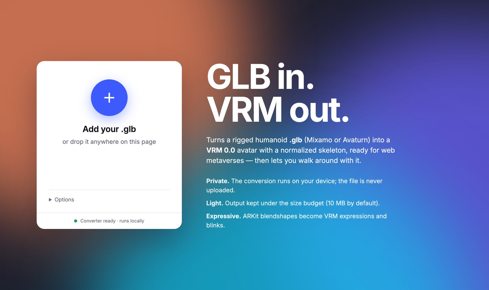
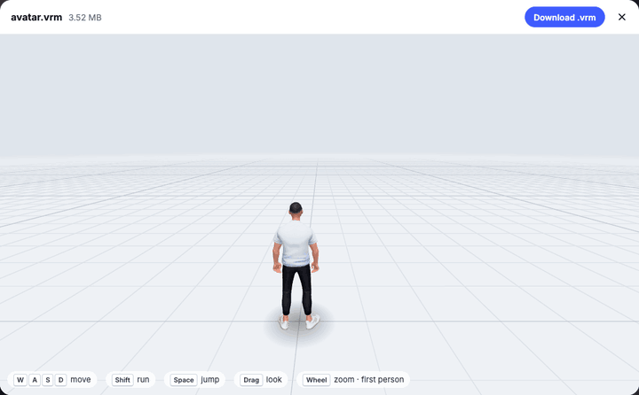

# GLBtoVRM

Turn a rigged humanoid **.glb** (Mixamo or Avaturn rig) into a **VRM 0.0** avatar, right in your browser, then walk around with it before downloading.

**▶ Try it: [glbtovrm.netlify.app](https://glbtovrm.netlify.app)**





- **Private**: the conversion runs on your device (Python in WebAssembly via Pyodide). The file is never uploaded.
- **Ready for web metaverses**: normalized skeleton (bones carry translation only), straight T-pose, facing -Z, the layout Hyperfy expects.
- **Light**: the output stays under a size budget (10 MB by default).
- **Expressive**: ARKit blendshapes become VRM expressions (a/i/u/e/o, blink, joy, angry, sorrow, fun).

## Run it locally

You need Python 3 and an internet connection (Pyodide, three.js and three-vrm load from jsDelivr). From this folder, run:

```bash
python3 -m http.server 8000
```

Then open <http://localhost:8000/> and drop a `.glb` anywhere on the page, or click **+** to pick one. Opening `index.html` straight from disk (`file://`) does not work, because browsers block web workers and module imports there. The first conversion takes a little longer, because the browser downloads the Python runtime (about 15 MB) and caches it. Each conversion after that takes about 10 seconds.

Any static host works for deployment, for example GitHub Pages: there is no build step and no backend.

## Try-it window

After a conversion, a window opens with the avatar on an endless floor. The controls and animations are the ones a Hyperfy player uses:

| Input | Action |
| --- | --- |
| `W` `A` `S` `D` / arrows | move relative to the camera (8-direction walk) |
| `Shift` | run |
| `Space` | jump |
| drag | look around |
| mouse wheel | zoom; below 1 m it switches to first person |
| touch | joystick on the left half, look on the right, **Jump** button |

## Animation editor

After converting an avatar, click **Animation editor** in the try-it window. On desktop, tools sit in the left sidebar with the full-body preview on the right and the timeline below it. On mobile, the preview stays above compact controls and the timeline; settings, precision inputs and exports expand only when needed. **Fit full avatar**, **Front**, **Side** and zoom buttons work with touch as well as a mouse. The camera reframes on viewport or panel-size changes.

1. Click a blue joint directly on the avatar (or choose a bone from the dropdown), then drag a colored rotation ring to pose it. The selected joint turns orange. Drag the background to orbit and use the wheel to zoom. Optional X/Y/Z values allow precise adjustments. **Skeleton** shows the bone hierarchy.
2. Click **Save pose keyframe** to record the whole body at the current time.
3. Move the timeline, change the pose and save another keyframe. Click a saved time to select it; **Delete keyframe** removes it.
4. Use **Play** and **Loop** to preview. Rotations interpolate using quaternion slerp. The initial keys at 0 and 2 seconds are the rest pose; replace them to set your start and end poses. Match the first and last poses for a seamless loop.
5. **Download animation .glb** exports the avatar's skeleton and one animation clip, without meshes or textures. **Download Hyperfy .glb** adapts humanoid bone names, thumb naming and quaternion axes to Hyperfy's emote importer. Eye animation is omitted from the Hyperfy export because its importer has no eye mapping. The importer was checked against the local Hyperfy source; playback in a live Hyperfy world remains to be checked.
6. **Save project** downloads editable JSON; **Open project** restores it on an avatar with the required humanoid bones. The project uses humanoid bone names rather than avatar-specific node names. It is also kept in memory when closing and reopening the same avatar preview; save JSON to keep it across page reloads or a new conversion.

Duration can be 0.1–120 seconds and cannot be shorter than the last saved key. Extend it before placing keys later in time. Edits to a pose must be saved as a keyframe before scrubbing, playing or exporting. This first editor handles bone rotations; root translation, inverse kinematics, facial animation and video capture are future additions. Loop is a preview setting and GLB metadata hint: the destination player controls playback looping.

Validation (2026-11-01): browser checks on `campus-a-new.vrm` covered pose insertion/deletion, quaternion interpolation, JSON reload/validation, non-loop playback, switching modes, binary GLB reload and matching exported rotation. Direct joint selection and dragging the rotation rings were also checked in the browser. The studio layout was checked at desktop size, 390×844, 320×667 and 844×390; mobile panels and the timeline had no horizontal overflow, and the full-body preview reframed when panels opened. The Hyperfy export was passed through its actual `createEmoteFactory` and checked for body/finger mapping and restored authored rotation.

## Command line

The converter is a single script, `glb2vrm0.py`. The site runs this same script unchanged. It needs `numpy`, plus `Pillow` when textures are re-encoded or a material uses BLEND alpha.

```bash
pip install numpy pillow
python3 glb2vrm0.py avatar.glb avatar.vrm [normal.png] [--max-mb 10] [--author "Your name"]
```

The optional PNG becomes the normal map of the first material.

## What the input must be

- A binary glTF (`.glb`); convert FBX to GLB first, for example in Blender.
- One skin (armature), with every mesh skinned to it, exported in its bind (rest) pose.
- Mixamo-style bone names (`Hips`, `Spine1`, `LeftUpLeg`, `LeftHandIndex1`…); prefixes such as `mixamorig:` are fine.
- No Draco or meshopt mesh compression.

When the input breaks one of these rules, the page shows a one-line reason.

## What the converter does

1. Straightens the rest pose: legs vertical with feet flat, upper arm and forearm on the X axis. Avaturn rigs bend the forearm about 16° forward, which otherwise closes the arms on the body in animations.
2. Bakes every vertex, normal and morph target into that pose, and rebuilds the skeleton with translation only. It then turns the avatar 180° so it faces -Z, as VRM 0.x expects.
3. Writes the VRM extension:
   - humanoid mapping, including fingers and eyes;
   - firstPerson and lookAt settings;
   - expressions built from ARKit shapes;
   - glTF PBR materials. BLEND hair with an almost-binary alpha channel becomes MASK, to avoid three.js sorting artifacts.
4. Fits the size budget. Lossless compaction always runs. If the file is still too big, the converter takes the first of these steps that fits: textures at max 2048 px, then 1024, then 512, then 512 without morph normals, then 256 without morph normals.

The VRM metadata uses the author from the options, and a restrictive default license (redistribution prohibited, author-only use). Edit the metadata in a VRM tool if you need other terms.

## Files

| File | Role |
| --- | --- |
| `index.html`, `style.css` | page and styles |
| `app.js` | file picking and drag & drop, talks to the worker, download link |
| `worker.js` | loads Pyodide (numpy and Pillow) and runs `glb2vrm0.py` on the dropped file |
| `glb2vrm0.py` | the converter (also usable from the command line) |
| `viewer.js` | try-it scene: three.js 0.170 with @pixiv/three-vrm 3.4.2, player controller, camera, endless grid |
| `animation-editor.js` | keyframe editor, project save/load, GLB and Hyperfy emote export |
| `emotes.js`, `emotes/` | Hyperfy's locomotion clips and their retargeting onto the VRM |

## License

[GPL-3.0](LICENSE). Copyright (C) 2026 Marzio Camasso.

## Credits

- `emotes/*.glb` and the retargeting logic in `emotes.js` come from [Hyperfy](https://github.com/hyperfy-xyz/hyperfy) (GPL-3.0).
- Libraries loaded at runtime:
  - [three.js](https://threejs.org) (MIT);
  - [@pixiv/three-vrm](https://github.com/pixiv/three-vrm) (MIT);
  - [Pyodide](https://pyodide.org) (MPL-2.0), with NumPy (BSD) and Pillow (MIT-CMU).
